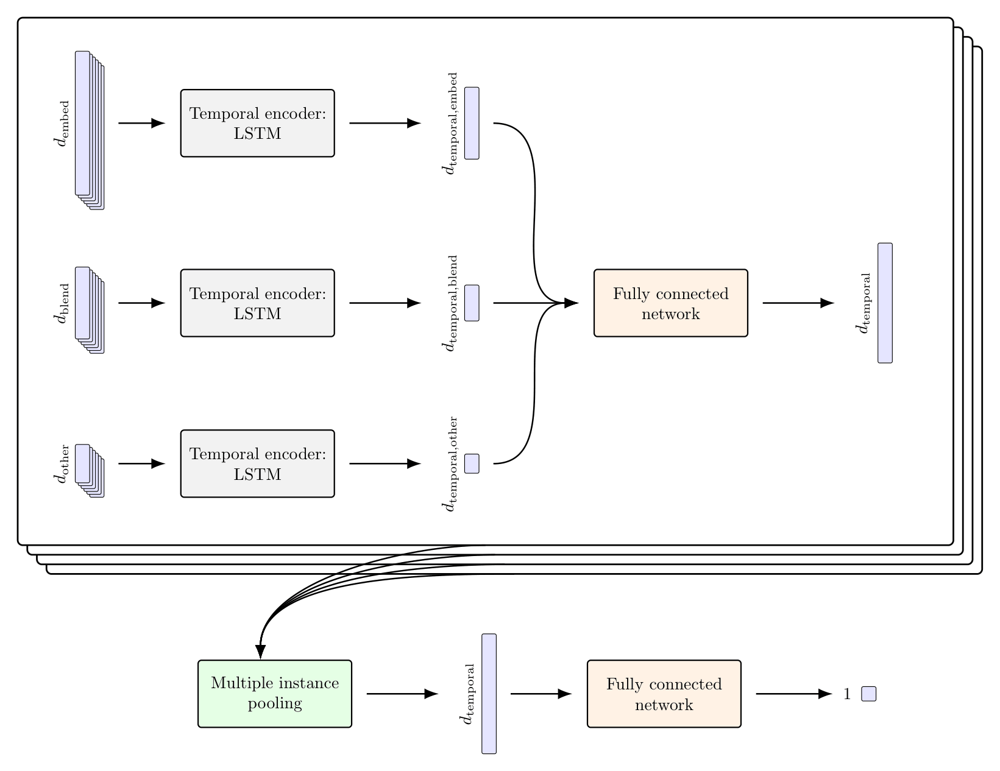
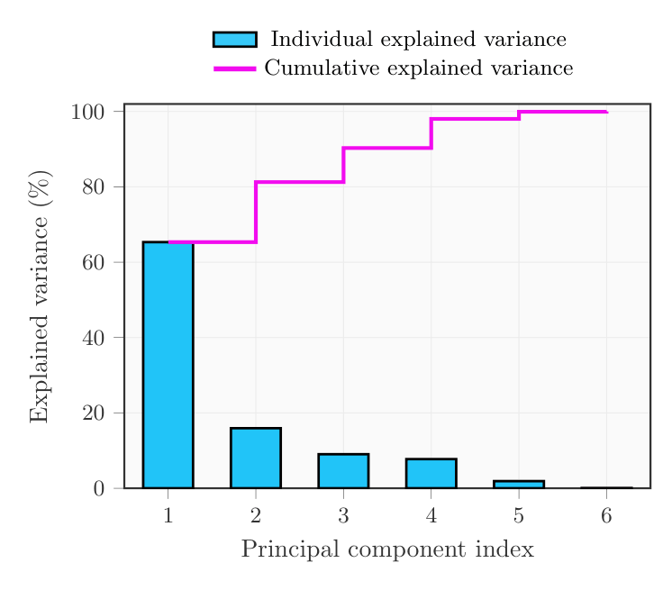
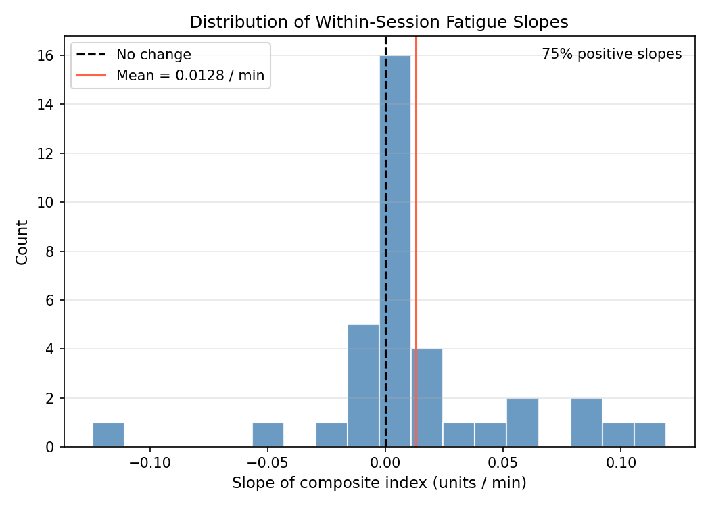

# Fatigue Detection Research

Research code and archived results for multimodal fatigue and drowsiness detection using facial video, EEG, and behavioral/self-report information. Includes preprocessing, feature extraction, video MIL training with nested cross-validation, exploratory notebooks, and PCA simulation studies. This is a research archive, not a production inference service.

## Research overview and selected findings

The research investigates whether **facial video can predict a proxy for fatigue** learned from supervision combining three kinds of measurements: EEG spectral features, psychomotor reaction times, and self-reported sleepiness (KSS). The measurements guide training; the proposed prediction pathway uses **video-derived features only**. The PCA-based composite is an indirect, correlational proxy, not a direct measurement of brain fatigue or a clinical diagnostic label.

**Video model architecture.** Temporal encoders process deep visual embeddings, facial blendshapes, and other facial features. Multiple Instance Learning aggregates selected video windows into a segment-level estimate. This schematic is the version referenced in the research manuscript, and shows LSTM encoders as one supported temporal backbone.



**Composite target.** The first principal component (PC1) of six standardized measurements (four reaction-time statistics, KSS, and EEG slow-over-fast ratio) accounted for approximately **65%** of the observed variance in the reported analysis. All six PC1 loadings have the same sign in the selected orientation.



**Temporal evidence.** In the reported within-session analysis of **36 session-subject pairs**, around **75%** had a positive composite-index slope and **24 of 36 (67%)** increased from the early to the late part of the session. These are measurements of the *constructed index*, not independently established video-prediction performance.



The research manuscript reports mean held-out test MAE of **0.293 on UTA-RLDD** (self-report target) and **0.70 on DROZY** (composite target). Their target definitions and scales differ, so the numbers **must not be used to rank or directly compare the datasets**. Results have not been independently rerun during repository documentation work.

For the rest of the exact thesis-referenced figures, the cross-modal evidence, the full reported validation/test MAE summary, and limitations, see **[Selected research results and visualizations](docs/research-results.md)**. [Figure provenance](docs/figure-provenance.md) records the manuscript figure labels and verified image identities. This public showcase does not include the thesis manuscript or source datasets.

## Structure

| Directory | Purpose |
| --- | --- |
| `src/preprocess/` | Video/EEG preparation and alignment |
| `src/process/` | Face embeddings, eventfulness, EEG scores, visualization |
| `src/utils/` | Shared functions and portable experiment configuration |
| `src/jobs/` | SLURM experiment submission and monitoring |
| `experiments/` | Distinct historical experiments, including E15 nested-CV video MIL |
| `models/`, `plots/`, `logs/`, `extra/` | Preserved models, figures, logs, notebooks and data products |
| `tests/`, `docs/` | Lightweight tests and engineering/reproducibility guides |

Do not delete or regenerate tracked model checkpoints, plots, or previous experimental results during routine refactoring.

## Setup

The repository historically imports `Zh.src` and `Zh.experiments`. Clone to a folder named `Zh` and run Python modules from its parent directory until those imports can be migrated with regression checks.

```bash
git clone https://github.com/Roobahist/fatigueDetection.git Zh
cd Zh
conda env create -f env.yaml
conda activate .cvenv
cd ..
python -m Zh.experiments.e15.main --help
```

`env.yaml` is a historical Linux/CUDA environment export, not a verified portable environment. Full model runs require authorized access to external datasets and compatible hardware.

## E15 configuration

E15 supports `FATIGUE_DATA_ROOT` and `FATIGUE_OUTPUT_ROOT`. Override these using `--data-root` and `--output-root`; individual resources can be overridden with `--embeddings-dir`, `--features-dir`, `--eventfulness-scores-dir`, `--normalization-info-path` and `--kss-score-path`. `--output_dir` continues to take priority when provided. The original data root remains a compatibility default only.

```bash
export FATIGUE_DATA_ROOT=/path/to/datasets
export FATIGUE_OUTPUT_ROOT=/path/to/outputs
python -m Zh.experiments.e15.main --help
```

For the complete research workflow, read [architecture](docs/architecture.md), [reproducibility](docs/reproducibility.md), and [migration notes](docs/migration-notes.md). Existing `experiments/e15/configs/*.conf` files are HPC-specific historical examples.

## Lightweight checks

From the parent of `Zh`:

```bash
PYTHONPATH=. python -m unittest discover -s Zh/tests -v
find Zh/src Zh/experiments/e15 -type f -name '*.py' ! -path '*/archive/*' -print0 | xargs -0 -r python -m py_compile
bash -n Zh/src/jobs/submit_job.sh Zh/src/jobs/manage_experiments.sh
```

These tests do not retrain models, verify original participant data, or establish numerical equivalence to published historical results.
