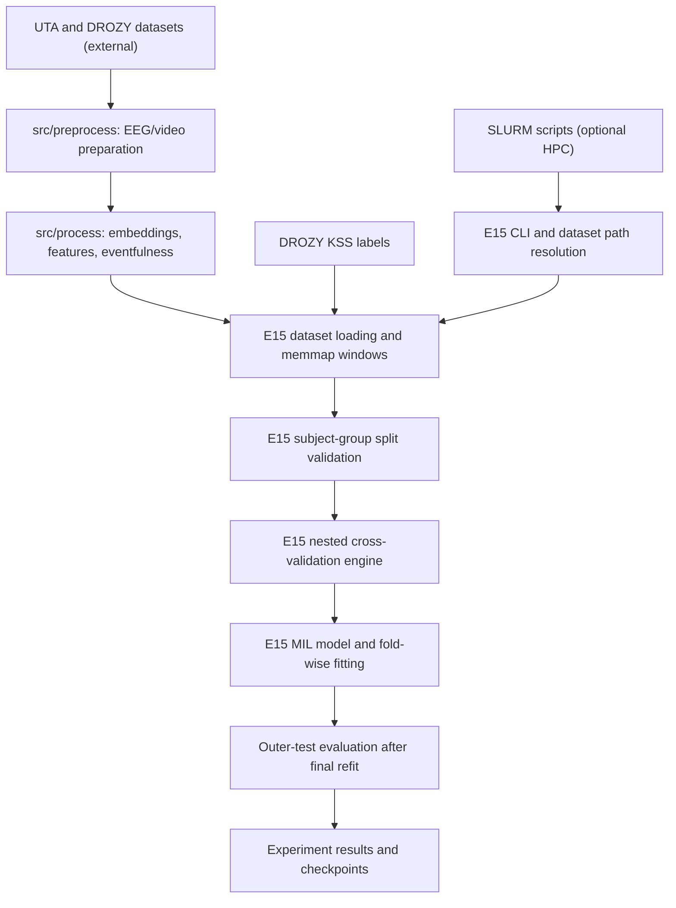

# Architecture

The diagram describes verified module roles for the E15 video workflow, not every experimental revision or an actual deployment topology.

`experiments/e15/main.py` builds the data, model, selection, training and CV configs; `src/utils/experiment_data.py` resolves paths and parses original labels independently of ML libraries. `experiments/e15/datasets.py` loads eventfulness-selected memmap windows; `video_mil_adapter.py` links the loaders and model to `nested_cv_engine.py`. `src/jobs/` contains optional SLURM job orchestration.

The diagram is manually-authored Mermaid grounded in inspected source code. Archify was unavailable, so no Archify output is claimed. Historical E1-E14 scripts and separate simulation studies are preserved without structural changes.
