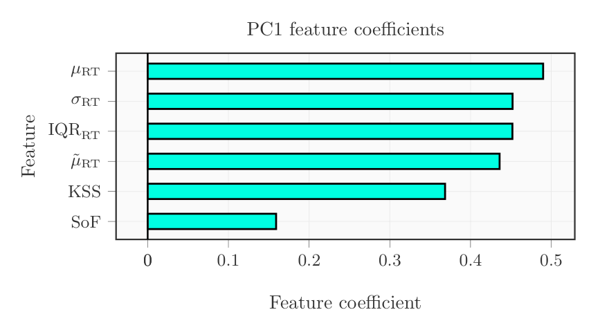
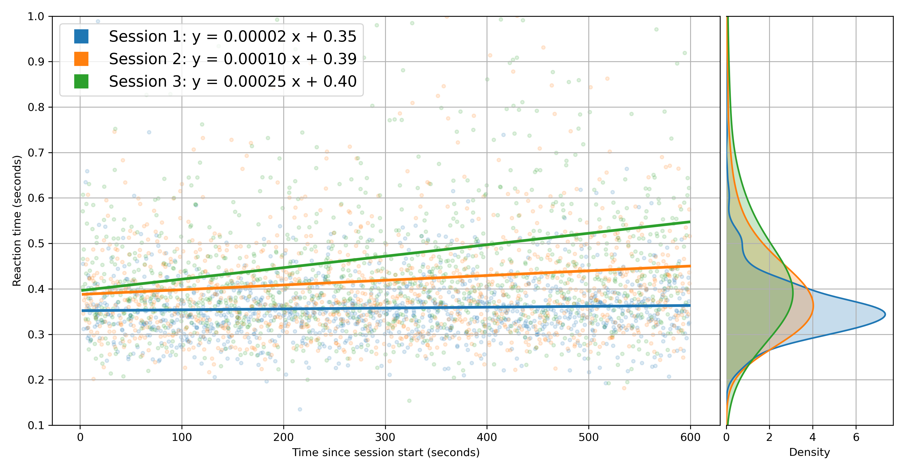
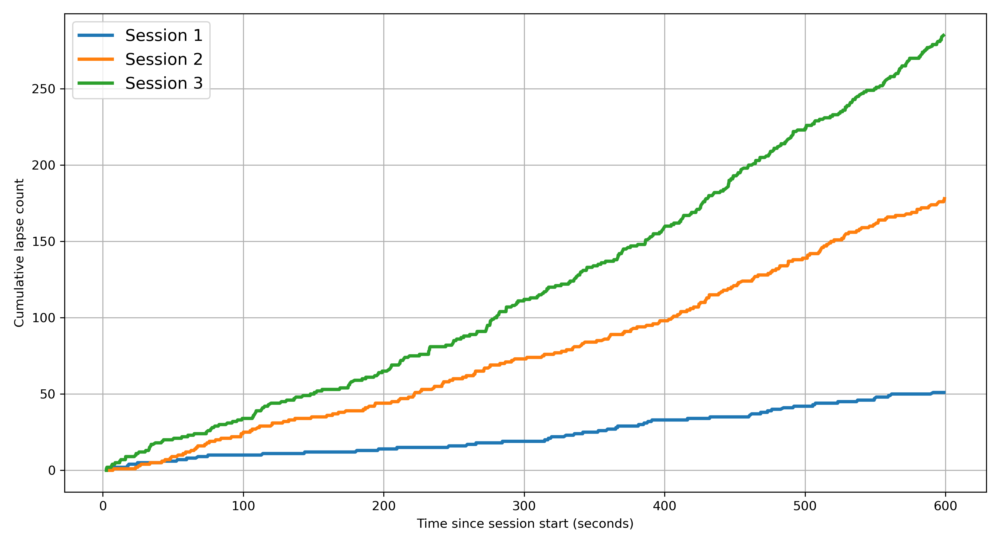
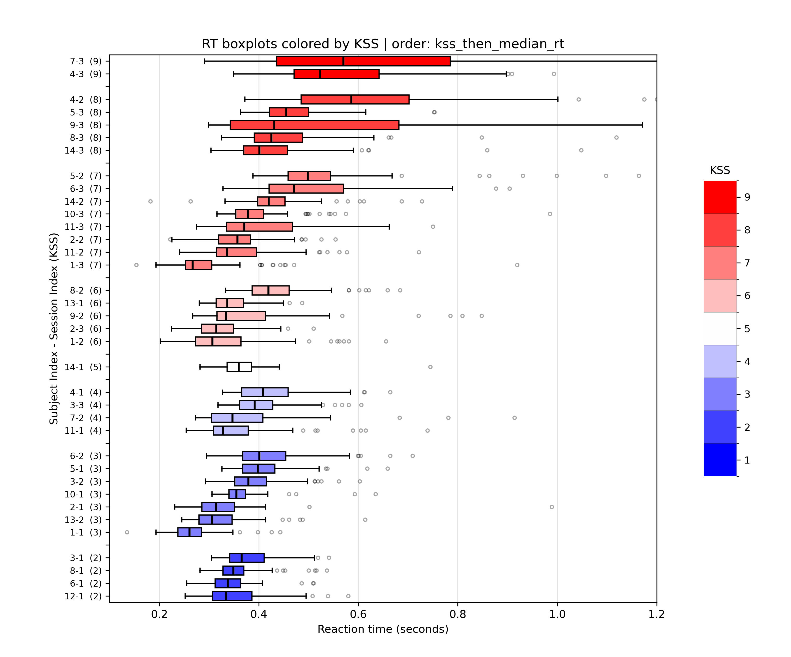
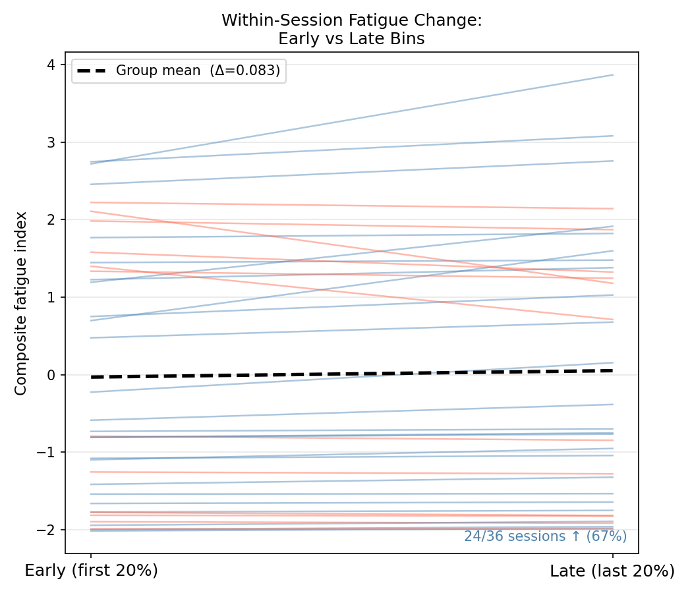
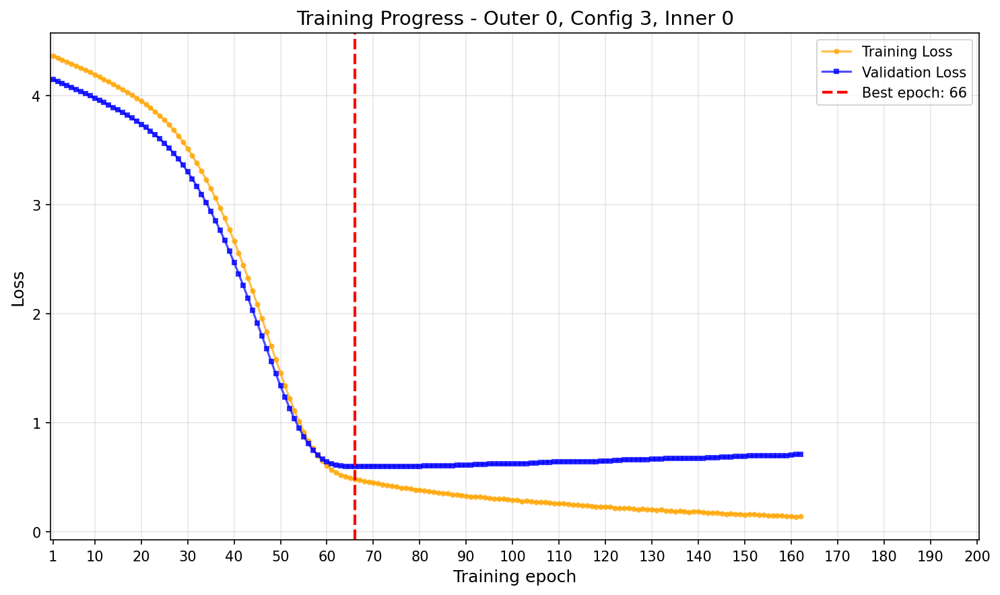
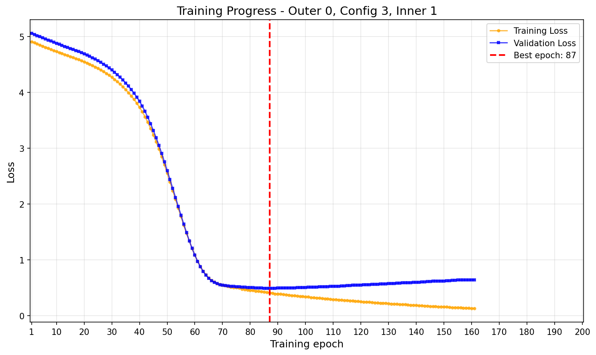
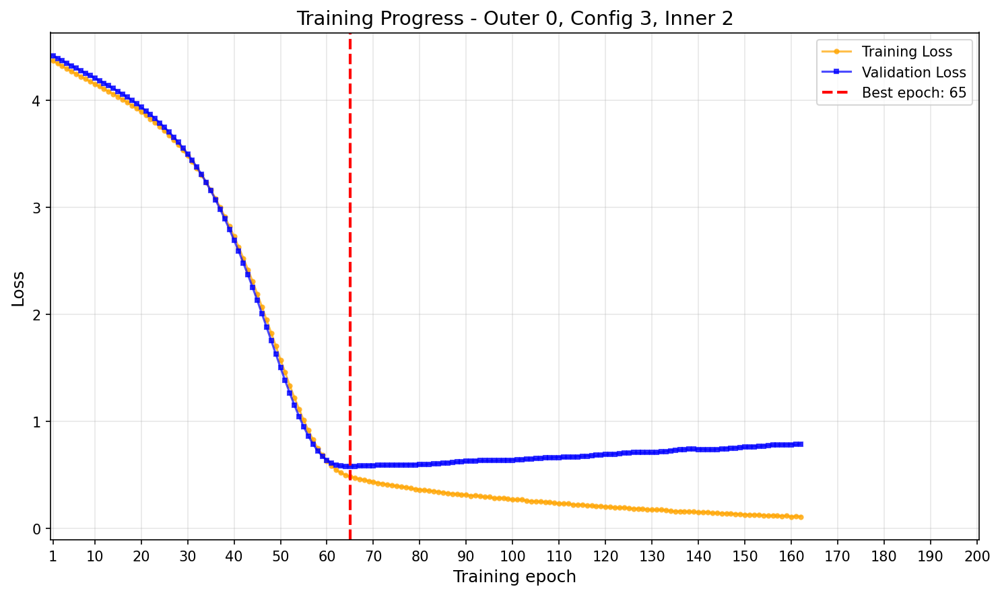

# Research results and selected visualizations

This page documents a **curated selection of plots and summary numbers actually referenced in the current research manuscript**, rather than alternate plotting versions or every exploratory output. Graphics transferred from the research manuscript were byte-identical; plots already tracked here were reused only after their Git blob hashes matched. A [figure manifest](figure-provenance.md) records exact references and paths.

The work explores a video-only prediction model trained under weak supervision from a multimodal fatigue proxy. **The composite index is not directly observed ground truth**, and the numbers below are transcribed from the manuscript, not newly verified on original datasets.

## 1. Modeling approach: video inputs, multimodal supervision

The proposed training target combines **EEG slow-over-fast spectral ratio**, **reaction-time behavior** (mean, standard deviation, IQR, and median), and **KSS self-report**. Principal component analysis of those six features supplies a composite training signal. At prediction time, the intended system uses facial video features, not continuously measured EEG or reaction-time tests.

*Manuscript Figure `fig:model`: a schematic showing three within-window temporal feature streams feeding a fusion network, Multiple Instance Learning aggregation over windows, and a final prediction head. LSTM is the backbone drawn in this figure; it does not imply that every experiment used exactly that backbone.*

This is a research pipeline, not a validated medical device or a deployed real-time application. It separates the construction of a training target from inputs required for the proposed prediction path.

## 2. PCA composite: what the target represents

*Manuscript Figure `fig:pca_variance`: PC1 explains approximately **65%** of the variance across six standardized features; PC1 plus PC2 explain a little over **80%**.*

*Manuscript Figure `fig:pc1_loadings`: the four reaction-time coefficients are approximately 0.44 to 0.49, KSS around 0.37, and EEG slow-over-fast approximately 0.16. All six loadings are positive in the displayed orientation.*

The common positive loading direction supports interpreting PC1 as a **fatigue-related composite**, but a major portion of its weighting comes from correlated reaction-time features. Explained variance and a consistent sign alone cannot prove that the component uniquely identifies a physiological fatigue state.

## 3. Reaction time and subjective sleepiness: supporting evidence

*Manuscript Figure `fig:rt_scatter`: reaction-time observations and per-session fitted trends. The manuscript describes increasing baseline response time and within-session slope over the sleep-deprivation sessions.*

*Manuscript Figure `fig:lapses`: cumulative counts of reaction times exceeding 500 ms. The manuscript describes approximately **50, 175, and 280** lapses across Sessions 1, 2, and 3, respectively, across the analyzed recordings. These are aggregate counts, not individual subject rates.*

*Manuscript Figure `fig:rt_boxplots_kss`: substantial reaction-time dispersion remains within a single KSS rating, illustrating that self-report and behavioral performance are related but not interchangeable.*

These trends support the decision to include both behavioral and subjective measurements in the composite, while retaining their disagreements rather than treating either channel as a perfect label.

## 4. Temporal behavior of the composite target

*Manuscript Figure `fig:slope_dist`: the average within-session slope is approximately **+0.0128 composite units per minute**, with approximately **75%** of **36 session-subject pairs** having a positive slope.*

*Manuscript Figure `fig:group_early_late`: **24 of 36 pairs (67%)** show an early-to-late increase, with a reported group mean difference of **+0.083 composite units**.*

**Interpretation boundary:** these two plots evaluate how the *target constructed from observed measurements* changes within sessions. They do **not** by themselves establish the trained video predictor's temporal sensitivity or prospective clinical validity.

## 5. Reported video model evaluation

The manuscript reports subject-wise cross-validation, with distinct prediction targets for each dataset. Its average mean absolute errors (MAE) are:

| Dataset and training target | Mean train MAE | Mean validation MAE | Mean test MAE | Summary basis |
| --- | ---: | ---: | ---: | --- |
| UTA-RLDD, self-reported fatigue | 0.007 | 0.210 | **0.293** | 20 reported test/validation fold combinations |
| DROZY, PCA composite supervision | 0.38 | 0.54 | **0.70** | 12 reported test/validation fold combinations |

These are **reported averages of rows in the manuscript tables**, not an independent reproduction. They describe different targets with different numerical scales; their absolute MAE values are **not directly comparable**, and no claim of performance superiority follows from this table. Small subject populations and substantial between-subject variation limit generalization.

### Representative training dynamics

The following three panels are the exact images used together as *Manuscript Figure `fig:training_curves_combined`*, showing training and validation losses for a representative configuration across three inner folds.

| Inner fold 0 | Inner fold 1 | Inner fold 2 |
| :---: | :---: | :---: |
|  |  |  |

The selected checkpoint corresponds to the minimum validation loss in each illustrated fold. These curves illustrate the rationale for validation-based early stopping; they are not evidence that all model variants generalize equally well.

## Limitations and reproducibility

- The fatigue index is **a correlational surrogate** built from shared variance. It is not a uniquely identified latent cause or a direct EEG estimate at inference time.
- Predictions can be sensitive to subject identity, session protocol, camera modality, and distribution shift. Participant-disjoint evaluation is essential.
- The manuscript's comparisons of component measurements and index trajectories are **not a controlled ablation showing that the composite target outperforms every single-channel target**.
- The source manuscript contains claims about convergent validity and video temporal sensitivity beyond the figures reproduced here. Independent test-set correlations and subject-level predicted-versus-observed traces have not been verified as part of this documentation update, so those claims are not restated as established results.
- Numerical evaluation has not been rerun against original data. See [reproducibility guidance](reproducibility.md) for data, split, and environment requirements.

All selected visualizations are either reused byte-for-byte from existing repository assets or added as byte-identical images verified against the ones referenced in the manuscript. No thesis text files, full thesis document, participant source recordings, or manuscript-only tabular raw data are included.
